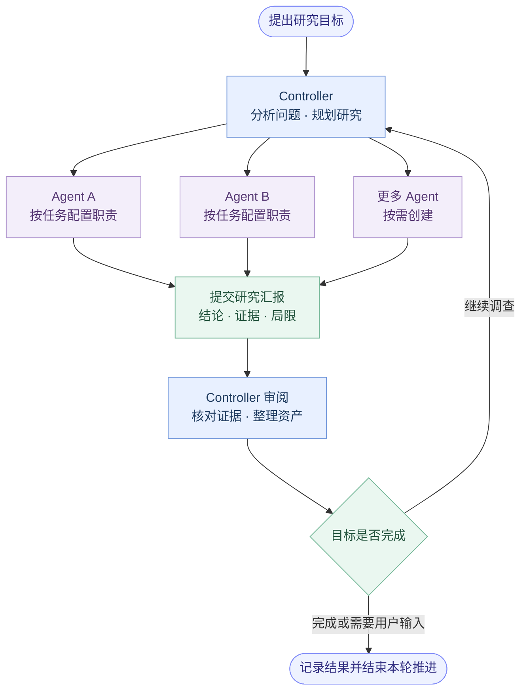
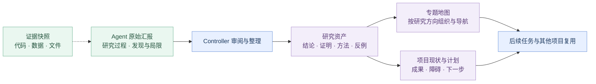
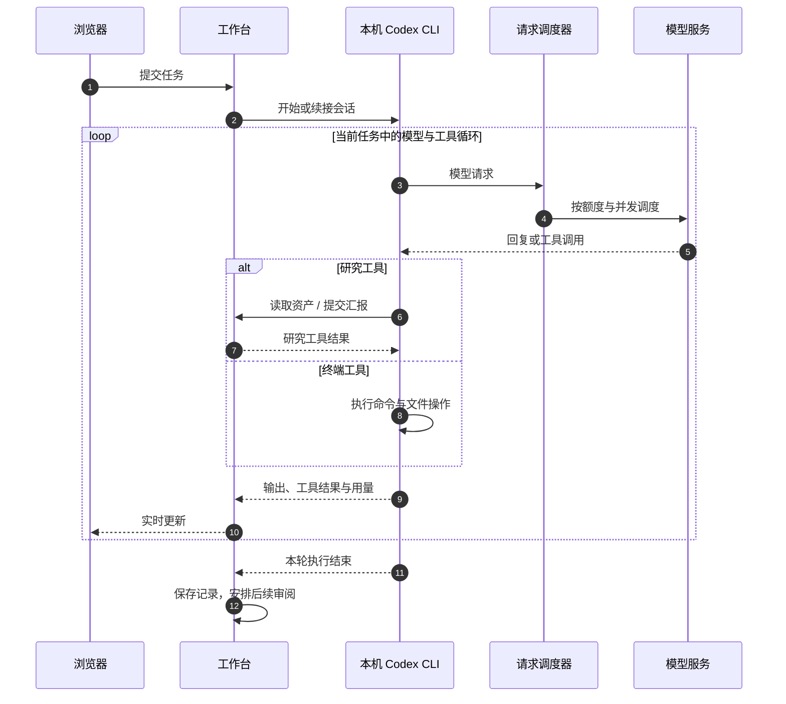
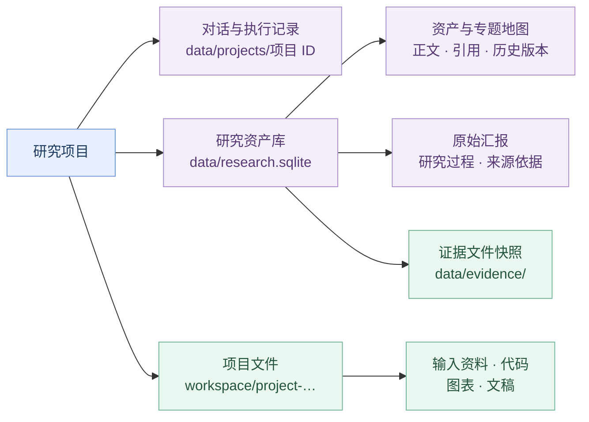

# DeepMath

**让多个研究 Agent 围绕同一个问题持续协作。**

Controller 围绕研究目标组织任务、协调多个 Agent 并审阅汇报；Agent 按配置的职责推进研究、交流发现，研究资产库保存可复用的成果与证据。

- **多 Agent 协作**：按任务配置研究职责，支持并行推进、协同交流和 Controller 自动调度。
- **研究资产管理**：整理成果、来源与证据，保留版本，通过专题地图组织和复用研究资产。
- **前端操作界面**：在浏览器中管理项目与团队、开展对话、查看运行过程和上下文用量、操作资产与文件。

本机运行，使用 Node.js 24+ 和 Codex CLI。打开网页直接使用，项目和 Agent 数量由实际资源决定。

## 快速开始

以下命令均在工作台目录（包含 `package.json` 的目录）执行。从活动仓库根目录进入时，先运行：

```bash
cd workbench
```

### 1. 准备环境

安装 [Node.js 24+](https://nodejs.org/)，在终端安装此项目使用的 Codex CLI 版本。

```bash
npm install -g @openai/codex@0.167.0
codex --version
```

### 2. 初始化配置

在工作台目录执行。

```bash
npm run setup
```

填写两个文件。

| 文件 | 需要填写 |
| --- | --- |
| `.env` | `deepmath_model_base_url` 接口地址、`AZURE_OPENAI_API_KEY` 模型 Key |
| `models.config.json` | `apiModel` 实际模型或部署名，以及模型支持的参数 |

`.env.example` 和 `models.config.example.json` 是初始化模板。`package.json` 保存启动与测试命令，日常无需修改；调度参数默认内置。

接口地址填到 `/v1` 层级，例如 `https://your-resource.services.ai.azure.com/openai/v1`。配置详情见 [模型配置](MODEL_CONFIGURATION.md)。

### 3. 启动工作台

```bash
npm run check
npm start
```

打开 `http://127.0.0.1:4176`。创建项目、填写目标，然后在 Controller 对话中提交任务。可以手动添加 Agent，也可以让 Controller 按任务需要创建。开启“自动运行”后，Controller 会持续审阅和推进项目目标。

终端按 `Ctrl+C` 停止。再次执行 `npm start` 可继续已有项目。Windows PowerShell 若拦截 `npm` 脚本，可使用 `npm.cmd`。

## 前端操作界面

**通过网页组织研究、跟进执行，并管理研究成果。**

| 界面 | 主要操作 |
| --- | --- |
| 项目中心与总览 | 创建和切换项目，查看研究目标、团队状态与最近进展 |
| Controller / Agent 对话 | 提交指令、配置 Agent 职责、用 `@` 选择 Agent，查看回复、推理与工具记录 |
| 运行与模型控件 | 选择模型和推理强度、查看上下文 token 统计、开启或暂停自动运行、停止当前请求 |
| 研究资产库 | 浏览专题地图、检索和编辑资产，追溯来源与证据，查看版本和导出记录 |
| 项目文件 | 上传、浏览、预览和下载研究资料与生成文件 |

## 多 Agent 如何协作

**Controller 负责判断下一步，Agent 负责研究与汇报。**



图中表示协作关系，Agent 数量和职责按实际任务确定，可由用户配置，也可由 Controller 按需创建和分配任务。Agent 可相互交流并提交研究汇报；Controller 根据证据整理资产、安排后续工作、确认完成或向用户提出具体问题。

## 研究资产管理

**把研究过程沉淀成有来源、可核查、可继续使用的知识。**



| 内容 | 保存什么 |
| --- | --- |
| 原始汇报 | Agent 提交的详细研究过程、依据、局限与继续位置 |
| 研究资产 | 可复用的结论、证明、方法、反例、部分成果与开放问题 |
| 专题地图 | 资产之间的组织结构和阅读入口 |
| 项目现状 | 当前判断、已选成果、障碍和下一步计划 |

资产可关联来源汇报和引用，修改时保留历史版本；提交的证据文件按内容快照保存。Controller 在研究回合中整理汇报、合并重复成果并核对受影响的引用。

点击侧栏“研究资产库”，按项目或全库浏览专题地图、检索和编辑资产；打开记录后可查看来源与证据，在“⋯”菜单中查看历史版本、导出记录。同一项资产可添加到多个项目或专题，供后续研究复用。

## 模型与工具如何配合

**一次研究执行可以包含多次模型请求与工具调用。**



工具在本机执行，项目使用独立会话目录。调度器在工具执行期间释放模型请求名额，对工具结果续接给予有限优先权。限流由后台按接口冷却时间继续调度，用户可停止当前任务。

## 配置模型

**连接信息放在 `.env`，模型列表放在 `models.config.json`。**

```json
{
  "defaultModel": "research",
  "models": [
    {
      "id": "research",
      "displayName": "研究模型",
      "apiModel": "your-deployment-name",
      "apiMode": "responses",
      "reasoningEffortSupported": false,
      "maxOutputTokens": 8192
    }
  ]
}
```

`id` 用于保存模型选择，`apiModel` 用于实际请求。推理档位按所用部署的支持范围填写。当前提供 Responses 接口适配和 Azure DeepSeek Pro 混合模式，普通 Chat Completions 地址需先提供兼容适配。

页面右上角的“模型配置”显示生效配置，输入框旁可选择本次任务的模型与推理强度。修改配置文件后重启。高级配置及 Pro / Flash 示例见 [MODEL_CONFIGURATION.md](MODEL_CONFIGURATION.md)。

## 研究记录保存在哪里

**对话保留执行过程，资产库组织研究结果，项目文件区保存实际文件。**



默认目录为 `data/` 和 `workspace/`，可在 `.env` 中调整。资产库供本实例的项目复用，保存结论、来源和版本。对话保存服务实际收到的回复、推理与工具记录。

备份时先停止工作台，再复制完整的 `data/` 和 `workspace/`。页面上传默认检查每项目 100 MiB，修改 `deepmath_max_project_mb` 可调整到当前支持的 1–100 MiB 范围。本机命令直接写文件遵循本机磁盘和执行权限。

工作台默认监听本机地址。共享访问本实例的浏览器共用项目与数据，本机工具以启动工作台的系统账号执行。

## 源码与检查

```text
src/       后端源码：项目管理、Agent、模型调度、研究资产
public/    网页界面
scripts/   初始化与配置检查
test/      回归测试
.codex/    研究方法与提示词
```

入口为 `src/server.js`，日常使用只需在工作台目录运行 `npm start`。模型配置文件和 README 保留在工作台目录，便于查找和填写。

```bash
npm test
npm run check:open-source
```

测试使用合成数据及本地模拟服务。项目采用 [MIT License](../LICENSE)。Codex CLI 的安装与进程协议可查阅 [OpenAI 官方文档](https://developers.openai.com/codex/app-server)。
